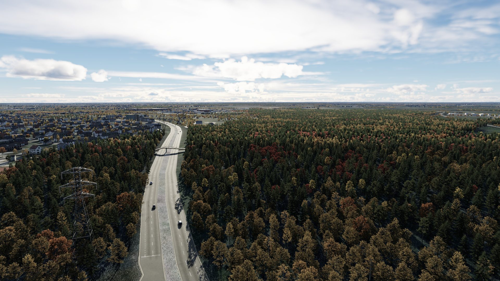
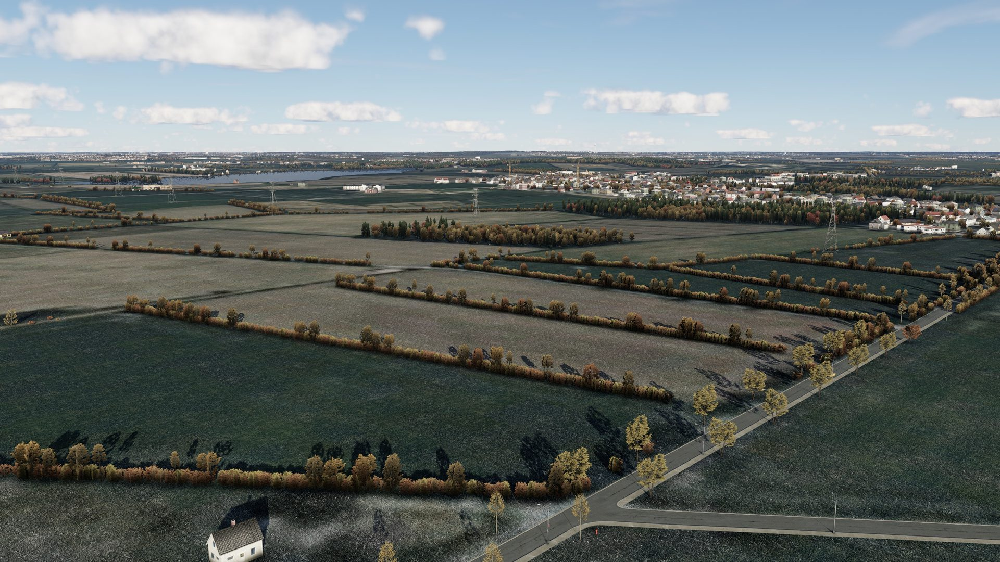
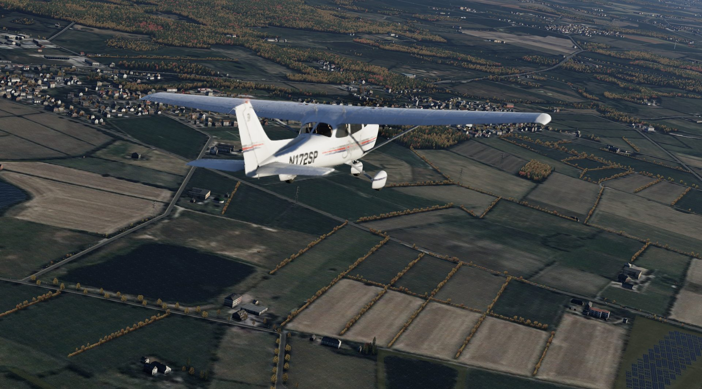
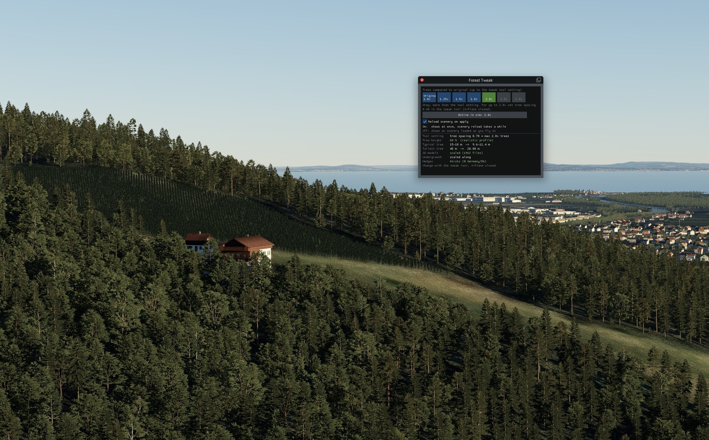

# XP12 Forest Tweak

**Denser, more realistic forests for X-Plane 12 – for vanilla, simHeaven X-World and Global Forests v2. Optionally smaller trees. Windows, macOS and Linux.**

> **Free community project – not for sale.** Free to use for everyone, including companies and flight schools. See [License](#license).

Even with the vegetation slider at maximum, X-Plane 12 forests often look like loose groups of trees instead of a forest. That's because the slider can never go above the density set in the forest definition files (`.for`). This tool lowers the tree spacing in those files, safely and reversibly.

Tree spacing 0.7 (preset *Dense*) ≈ **twice as many trees per area.**

## Screenshots

Same view over the Inn valley near Innsbruck, with simHeaven X-World and Global Forests v2.

| Before (original density) | After (Forest Tweak applied) |
|---|---|
|  |  |

Autumn, wide view over a hilly forest region: the original forests show ground between the trees, with the tweak the forest canopy is closed.

| Before (original density) | After (Forest Tweak applied) |
|---|---|
|  |  |

Dense autumn forest with the tweak applied.



Knicks option in northern Germany: hedges and tree rows become Knicks with bushes and single trees.

| Knicks near the ground | Knicks from the air |
|---|---|
|  |  |

In-sim window (`ForestDensityToggle.lua`): density from 1.0x to 2.8x as many trees as the original, scenery reload option and the settings of the tweak.



---

## Features

- **Windows, macOS and Linux:** one tool per system with the same logic and the same backup log, so a tweak made on one system can be restored on the other
- **Simple menu:** Choose settings · Restore original · Status · Check & repair. You pick all values first and confirm a summary before anything is changed
- **Presets for the tree spacing:** *Natural* 0.8, *Dense* 0.7 (recommended), *Very dense* 0.6, or your own value from 0.4 to 1.0
- **Optional tree height:** factor 0.5 – 1.0, with a *uniform* or *realistic* height profile. The 3D tree models are scaled too, so near and far trees match
- **Global Forests v2 cropland:** field trees and hedgerows between fields get an extra factor 0.8, so field edges are filled more evenly
- **Fuller sparse forests (Global Forests v2):** sparse forest areas get extra trees, dense areas stay as they are
- **Optional: simHeaven hedges** *default*, *enhanced* (taller) or **Knicks** – real-looking Knicks with bushes and trees in northern Germany and Denmark, see below
- **Fully reversible:** the original values are logged and restored byte-for-byte; 3D model backups are protected by a checksum
- **Quick to reapply after updates:** reset files are detected and tweaked again, already tweaked files are skipped
- **Never applied twice:** all versions share one backup log
- **Grass, shrubs and hedges are left alone:** only files with a spacing above 3.1 m are changed
- **Safe if interrupted:** every change is logged before the file is swapped in; Ctrl+C or a full disk stops cleanly
- **Helpful checks at start:** vegetation slider not at maximum, Global Forests v2 disabled in `scenery_packs.ini` or active but not tweaked, X-Plane running, untested X-Plane version, new tool version available
- **Optional in-sim window:** a small FlyWithLua script switches the forest density during flight, from original up to the tool setting (1.0x · 1.25x · 1.5x · 1.8x · 2.0x · 2.5x · 2.8x as many trees), see below

## Installation & usage

> **This is not a plugin.** It is a small tool you run once, outside X-Plane. Do not copy it into `Resources\plugins`. Only the optional in-sim window (`ForestDensityToggle.lua`) goes into the FlyWithLua folder, see below.

1. **Quit X-Plane.** The tool won't change anything while X-Plane is running.
2. Download the ZIP for your system from [Releases](../../releases) (`…_Windows.zip`, `…_macOS.zip` or `…_Linux.zip`) and unzip it anywhere. No renaming needed. If you unzip it into your X-Plane 12 folder, X-Plane is found automatically. Otherwise the tool reads `x-plane_install_12.txt` or asks for the path.
3. Start the tool for your system (see below). If Global Forests v2 is installed, it asks whether to include it.
4. Choose from the menu:
   - `1` **Choose settings** – tree spacing, tree height, height profile and (with simHeaven X-World) hedges, Knicks and the hedgerow map, step by step. Then a summary with an estimated time is shown; nothing is changed until you confirm it. With tree height and Global Forests v2 it can take 10 minutes or more
   - `2` **Restore original** – puts back the original forests and hedges
   - `3` **Status** – how many forest files are tweaked, hedges, other scenery with its own forests
   - `4` **Check & repair** – checks the backups, removes leftovers of an interrupted run and cleans up the log
   - `5` **Switch to original / back to tweak** – switches between your tweak and the original forests, hedges and Knicks in a few seconds, without calculating again

Run it once. Run it again only after an X-Plane or Global Forests update.

### Windows

Double-click `Start_ForestTweak.bat`. One tool for vanilla X-Plane, simHeaven X-World and Global Forests v2.

No admin rights needed. Uses PowerShell, which ships with Windows 10/11.

Coming from 1.3 or older: just use the new tool – it reads the same backup log. You can delete the old `Start_Vanilla-simHeaven.bat`, `Start_GlobalForestsV2.bat` and their `.ps1` files.

### macOS

Double-click `Start_ForestTweak_macOS.command`.

- macOS blocks downloaded scripts the first time: right-click the file → *Open* → *Open*.
- Needs Python 3.8 or newer. If it is missing, macOS offers to install the *Command Line Developer Tools*, which include Python 3. Alternatively install it from [python.org](https://www.python.org/downloads/macos/).
- Without double-click: open Terminal and run `python3 ` followed by the path of `xp12_forest_tweak.py` (drag the file into the Terminal window).

### Linux

Open a terminal in the unzipped folder and run:

```
sh start_forest_tweak_linux.sh
```

Needs Python 3.8 or newer (preinstalled on most distributions).

### Tree spacing

Lower spacing = closer trees = denser forest. 1.0 = original.

| Preset | Spacing | Effect | GPU load |
|---|---|---|---|
| Natural | 0.8 | noticeably denser (≈ 1.6× trees) | low |
| **Dense** | **0.7** | **≈ 2× trees, recommended** | medium |
| Very dense | 0.6 | ≈ 2.8× trees | high |
| Custom | 0.4 – 1.0 | your own value | |

Values can be typed as `0.7`, `0,7` or `70`.

**Global Forests v2 cropland:** the *cropland* forests of GFv2 (single trees and hedgerows between fields) get an extra factor 0.8, e.g. spacing 0.7 → 0.56 there. This fills field edges more evenly without making the real forests even denser.

**Fuller sparse forests (Global Forests v2):** GFv2 sorts every forest area by satellite data into one of four density steps, from very sparse to very dense. The very sparse areas get almost twice as many trees as before, the sparse ones a few more, the dense ones stay as they are. A sparse forest still looks lighter than a dense one, but no longer empty. This is always on when Global Forests v2 is included.

### Tree height (optional)

| Height factor | Effect |
|---|---|
| **1.0** | **unchanged (default)** |
| 0.8 | trees 20 % smaller |
| 0.5 | half height (minimum) |

Below 1.0 you choose a height profile:

| Profile | Example at 0.8 |
|---|---|
| **uniform** | every tree 0.8 |
| **realistic** | broadleaf, mixed, cropland 0.8 · conifers 0.88 · palms 0.84 · shrubs, orchards, cacti 0.9 |

*realistic* takes into account that conifers are often the tallest trees in reality, while shrubs and orchards are small anyway.

**All trees, including the 3D models.** The height factor scales the distant billboards *and* the close-up 3D models, so near and far trees match without popping. Example: at 0.8 a 12–17 m tree becomes 9.6–13.6 m.

Scaling the 3D models rewrites the forest files (a few minutes; the macOS/Linux version uses several CPU cores). A compressed copy of each original, with a SHA-256 checksum, is kept in `ForestDensityTweak/mesh_backup` (about 1.5 GB with Global Forests v2) for an exact restore. Free disk space is checked before every file is written.

To change a value later, just run *Choose settings* again: the tool restores the originals first and then applies the new values.

### simHeaven hedges / Knicks (optional)

simHeaven X-World draws hedges from OpenStreetMap, for example the typical *Knicks* (hedgerows on earth walls) in northern Germany. By default they are only 2.2–2.8 m high and disappear 4 km away, so from the air the fields look bare.

Step 4 of *Choose settings* switches them between:

| Setting | Hedges | Visible up to |
|---|---|---|
| **default** | 2.2–2.8 m | 4 km |
| **enhanced** | about 4–5 m | 8 km |
| **Knicks** | Knick areas in Germany and Denmark: Knicks with bushes and single trees, tree rows with mixed trees, denser scrub. Optional: exact Knicks from the hedgerow map (Schleswig-Holstein). Elsewhere: *enhanced* | 8–10 km |

**Knicks:** in the Knick and Wallhecken areas – Schleswig-Holstein, Hamburg, north-west Lower Saxony (Ostfriesland, Oldenburger Land, Elbe-Weser, Emsland, Osnabrück-Nord, Heidekreis), west Mecklenburg and Denmark – the simHeaven hedges become typical Knicks (bushes of 1.5–8 m with Ueberhaelter of 6–14 m – oaks, ashes and maples – changing in sections of about 100 m, some sections without trees; all scaled by your tree height), the simHeaven tree rows get mixed trees with bushes in between, and scrub areas (often narrow Knick strips in OpenStreetMap) get dense bushes with a few small trees. X-Plane can only limit this to whole 1×1° tiles, so some neighbouring areas are included too (e.g. Hannover, Rostock, western Skåne). The tool creates a small library for this in `Custom Scenery/XP12_ForestTweak_Knicks` (the trees are copied from the X-Plane default forests, about 12 MB) and lists it above simHeaven in `scenery_packs.ini` (a backup is kept in `ForestDensityTweak`). Knicks and tree rows follow your tree height factor. simHeaven files are not changed for this; *Restore original* removes the folder and the line again. Knicks only appear where OpenStreetMap has hedges or tree rows – missing ones are not added.

**Hedgerow map Northern Germany/Denmark (optional, step 5):** with Knicks on, the tool can also use the official map of all Knicks, field hedges, tree rows and avenues of Schleswig-Holstein (Biotopkartierung SH4, about 60,000 km). Many of them are missing in OpenStreetMap. The map comes with the tool (`hedgerow_map_sh.dat`, about 6.5 MB) and is turned into scenery tiles on your computer, in `Custom Scenery/XP12_ForestTweak_HedgerowMap` (about 35 MB, takes about a minute). Knicks and field hedges become 1.6 m wide Knick strips, tree rows get a tree about every 7 m and avenues a row on both sides. In these tiles the simHeaven hedges and tree rows are replaced; the ones the map does not have (Denmark, Lower Saxony, Mecklenburg, gardens) are taken over from your own simHeaven scenery, so nothing is lost and nothing is doubled. The folder is listed above simHeaven X-World in `scenery_packs.ini`, because simHeaven removes the forests of scenery below it. *Restore original* removes the folder. Map data: LLUR SH, [CC BY 4.0](https://creativecommons.org/licenses/by/4.0/), see Credits.

Only the hedge files of the *simHeaven X-World Vegetation Library* are changed; the original lines are logged in `ForestDensityTweak/hedges.log` and restored exactly when you switch back. You can change it on its own by keeping the other values. Hedges are simple 2D billboards, so the cost is small, but in hedge-rich regions there are a lot of them. Not shown without simHeaven X-World. After a simHeaven update, run *Choose settings* again and confirm.

## I don't see a difference

The tool raises the maximum density in the forest files. What you see is still limited by:

- **The vegetation slider** in X-Plane (*Settings → Graphics*). It scales everything down from that maximum. The tool warns at start if it is not at maximum.
- **The forest data of the scenery.** Trees only grow where the scenery has forest areas. Where there are none (e.g. many fields, towns, some regions), no trees are added.
- **Other scenery with its own forests** (e.g. Orbx TrueEarth or photo scenery with own vegetation). Where it covers an area, its forests are shown. *Status* lists such scenery.
- **Global Forests v2 not included or disabled.** In GFv2 areas only the GFv2 forests count. The tool warns if GFv2 is active but not tweaked, or tweaked but disabled in `scenery_packs.ini`.
- **An X-Plane or GFv2 update** reset the files. Run *Choose settings* again.

## In-sim window (optional)

Switch the density in flight and see the tree height, height profile and hedge setting set by the tweak. The buttons show how many trees compared to the original: 1.0x · 1.25x · 1.5x · 1.8x · 2.0x · 2.5x · 2.8x (rounded). Steps above the tool setting are greyed out – the window can only show up to what the tool wrote into the forest files (0.7 = 2.0x, 0.6 = 2.8x). Needs the tweak applied and [FlyWithLua NG+](https://github.com/X-Friese/FlyWithLua).

1. Copy `FlyWithLua/ForestDensityToggle.lua` from the ZIP to `X-Plane 12/Resources/plugins/FlyWithLua/Scripts/`
2. In the sim: *Plugins → Forest Tweak → Show / hide window* (fallback: *Plugins → FlyWithLua → FlyWithLua Macros → Forest Tweak: window*)
3. Pick a step and press **Apply**. With *Reload scenery on apply* ticked it shows at once (the reload takes a while), otherwise on scenery loaded as you fly on. **Reload scenery** reloads at once at any time. The chosen step is remembered for the next flight; if it is below the tool setting, a note is shown on screen and in the window.

Key bindings: search `ForestDensity` in the keyboard settings.

## How it works

- **Tree spacing:** `SPACING` (tree distance) and `RANDOM` in each `.for` file are multiplied by the factor. The vegetation slider can never go above this value.
- **No grid lines:** in natural forests `RANDOM` (how far a tree may move away from its grid position) is set to at least half the tree spacing. With less, X-Plane leaves empty strips between the tree rows, which show up as lines in dense forests. Planted rows like orchards keep their grid.
- **Height:** min/max height in each file's tree list is multiplied by the factor (per forest type with the *realistic* profile). The 3D models are scaled to match.
- **Changed folders:** `Resources/default scenery/1200 forests`, plus `Custom Scenery/Global_Forests_v2` if you include it. Hedges option: `Custom Scenery/simHeaven_X-World_Vegetation_Library` (hedge files only). Knicks option: own folder `Custom Scenery/XP12_ForestTweak_Knicks` plus one line in `scenery_packs.ini`. simHeaven X-World links its forests to the default forest files, so they are covered too.
- **Backup:** original values in `<X-Plane 12>/ForestDensityTweak/backup.log`. **Keep this folder while the tweak is active.**
- **Tool log:** `ForestDensityTweak/tool.log` lists what the tool did – please attach it to bug reports.
- **Update check:** at start the tool asks GitHub for the latest release (max. 3 s, nothing is sent, silent if offline). It only shows a hint, it never downloads anything.

## Undo

- Use **Restore original** in the menu. It writes back the exact original values.
- To compare, use **[5] Switch to original**: forests, hedges and Knicks are original again, your tweak is kept next to the files (`.fdt_tweak` / `.fdt_orig`). **[5]** again switches back in a few seconds. The first switch keeps a copy of the original files (about as much disk space as the tweaked files, with 3D trees and Global Forests v2 a few GB). *Choose settings*, *Restore original* and *Check & repair* switch back to the tweak first.
- If a 3D model backup is missing or damaged, that file stays tweaked (it is never scaled twice). Run the X-Plane installer (*Update*) or reinstall Global Forests v2, then **Check & repair**.

## Performance

More trees means more GPU work, especially when flying low over large forests. Check your FPS after applying. If needed, choose *Natural* (0.8).

## Compatibility

- Tested with **X-Plane 12.4.x** and FlyWithLua NG 2.8.12. Windows, macOS and Linux versions produce byte-identical results (checked on real forest files of X-Plane and Global Forests v2).
- Backup logs of all earlier versions keep working. Running *Choose settings* once applies the latest improvements (GFv2 cropland and sparse forests) to a tweak made with an older version.
- The `.for` format and the `SPACING` command are documented in Laminar's [forest file format specification](https://developer.x-plane.com/article/forest-for-file-format-specification).
- Forests from other add-ons are not touched.

## Repository layout

| Folder | Content | Download |
|---|---|---|
| `Windows/` | `Start_ForestTweak.bat` + `XP12_ForestTweak.ps1` | `XP12_ForestTweak_v1.5.0_Windows.zip` |
| `macOS/` | `Start_ForestTweak_macOS.command` + `xp12_forest_tweak.py` | `XP12_ForestTweak_v1.5.0_macOS.zip` |
| `Linux/` | `start_forest_tweak_linux.sh` + `xp12_forest_tweak.py` | `XP12_ForestTweak_v1.5.0_Linux.zip` |
| `FlyWithLua/` | `ForestDensityToggle.lua` (in-sim window, all systems) | included in every ZIP |
| `data/` | `hedgerow_map_sh.dat` (hedgerow map, CC BY 4.0) | included in every ZIP |
| all of the above | Windows, macOS and Linux in one ZIP | `XP12_ForestTweak_v1.5.0_All.zip` |

Download the ZIP for your system from [Releases](../../releases) – each one contains everything you need.

## Credits

Inspired by the `.for` spacing approach discussed on the X-Plane.org forums.

Hedgerow map (`hedgerow_map_sh.dat`): based on data of LLUR SH, [Biotopkartierung SH4 – Alleen, Knicks, Feldhecken und Baumreihen](https://opendata.schleswig-holstein.de/dataset/sh4-biotopkartierung-der-alleen-knicks-feldhecken-und-baumreihen) (2023), licensed under [CC BY 4.0](https://creativecommons.org/licenses/by/4.0/). Changed: only the lines and their type are kept, coordinates rounded to 0.1 m and stored in a compact format; the tool turns them into X-Plane forest strips and tree rows. The map file is licensed under CC BY 4.0 (not under the tool license). Hedges and tree rows elsewhere come from simHeaven X-World (OpenStreetMap data, © OpenStreetMap contributors, ODbL) on your own computer and are not part of this tool.

## Changelog

See [CHANGELOG.md](CHANGELOG.md).

## License

© E11i0t09 – licensed under [Creative Commons Attribution-NonCommercial-ShareAlike 4.0 International (CC BY-NC-SA 4.0)](LICENSE).

**Additional permission:** anyone – including companies, schools and flight schools – may download and use XP12 Forest Tweak free of charge, also in a commercial environment (e.g. training, simulators, operations).

**Not allowed** without written permission: selling or renting it, bundling it with paid products or services, charging for downloads, or distributing modified versions commercially.

You may share and adapt it non-commercially, as long as you give appropriate credit and share your changes under the same license. **Exception:** the hedgerow map `data/hedgerow_map_sh.dat` is based on data of LLUR SH and licensed under [CC BY 4.0](https://creativecommons.org/licenses/by/4.0/), see Credits and `data/README.txt`. Copies of v1.0.0 to v1.2.1 obtained before 21 October 2026 were licensed under the MIT License.

## Disclaimer

Use at your own risk. Not affiliated with Laminar Research, simHeaven or GeoReality.
